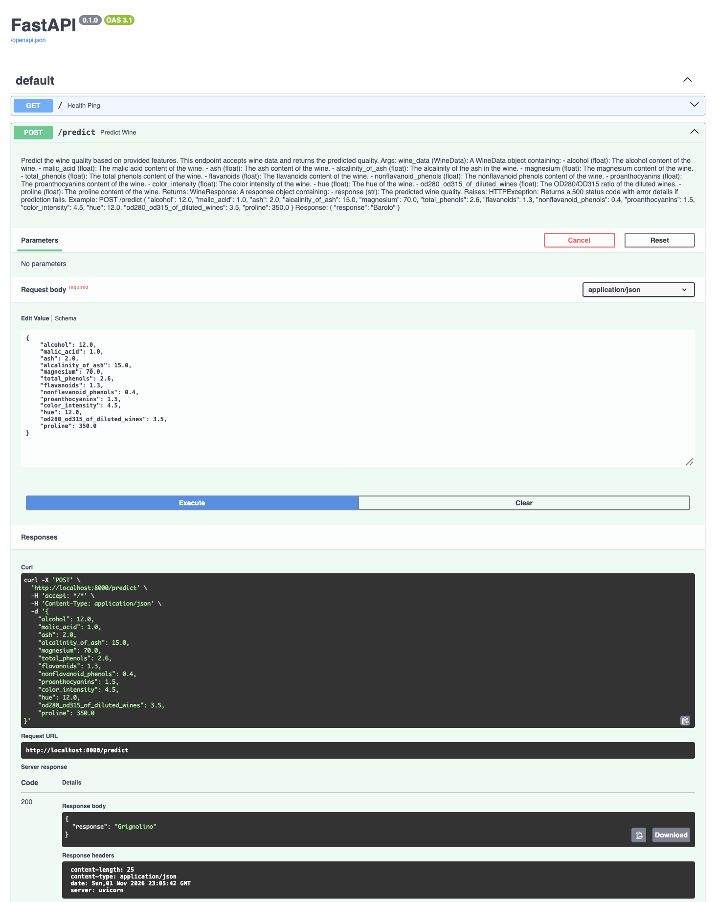

---

## Overview

In this lab, I learned how to expose ML models as APIs using [FastAPI](https://fastapi.tiangolo.com/) and [uvicorn](https://www.uvicorn.org/).
1. **FastAPI**: FastAPI is a modern, fast (high-performance), web framework for building APIs with Python based on standard Python type hints.
2. **uvicorn**: Uvicorn is an [Asynchronous Server Gateway Interface - ASGI](https://youtu.be/vKjCkeJGbNk) web server implementation for Python. It is often used to serve FastAPI aplications.

In this lab, I trained a neural network classifier on the scikit-learn Wine Dataset and served the trained model as an API using FastAPI and uvicorn.

## How I set up the lab

1. I created a virtual environment (for example, **fastapi_lab1_env**).
2. I activated the environment and installed the required packages using `pip install -r requirements.txt`.

### Project structure

```
mlops_labs
└── fastapi_lab1
    ├── assets/
    ├── fastapi_lab1_env/
    ├── model/
    │   ├── my_nn_wine_model.keras
    │   ├── wine_encoder.pkl
    │   └── wine_scaler.pkl
    ├── src/
    │   ├── __init__.py
    │   ├── data.py
    │   ├── main.py
    │   ├── predict.py
    │   └── train.py
    ├── README.md
    └── requirements.txt
```

Note:
- **fastapi[all]** in **requirements.txt** installed optional additional dependencies for FastAPI, including **uvicorn**.

## Running the Lab

1. First, I trained the neural network classifier. The repository includes a trained **`model/my_nn_wine_model.keras`** model and its **`wine_encoder.pkl`** and **`wine_scaler.pkl`** preprocessing artifacts, but I recreated them by moving into **src/**:
    ```bash
    cd src
    ```
2. I trained the Wine classifier by running:
    ```bash
    python train.py
    ```
3. I served the trained model as an API by running:
    ```bash
    uvicorn main:app --reload
    ```
4. I tested the endpoints and viewed the API documentation at [http://127.0.0.1:8000/docs](http://127.0.0.1:8000/docs) (or) [http://localhost:8000/docs](http://localhost:8000/docs) after running the FastAPI app.
    

   
I also tested the endpoint results by interacting with them: I clicked the endpoint dropdown, selected **Try it out**, filled in the request body, and clicked **Execute**.



- I also learned that other tools, such as [Postman](https://www.postman.com/), can be used for API testing.

### FastAPI Syntax

- I learned that an instance of the FastAPI class can be defined as:
    ```bash
    app = FastAPI()
     ```
- I learned that when running a FastAPI application, I pass the app instance to the Uvicorn ASGI server. The server then uses the app instance to handle incoming web requests and send responses based on the routes and logic defined in the application.
- I ran a FastAPI application with:
    ```
    uvicorn main:app --reload
    ```
- I learned that **main** is the name of the Python file containing the app instance (without the `.py` extension), and **app** is the name of the instance itself. The **--reload** flag restarts Uvicorn whenever code changes are detected, which is useful during development and should not be used in production.
- I learned that API functions are prefixed by **@app.get("/followed_by_endpoint_name")** or **@app.post("/followed_by_endpoint_name")**. This syntax defines route handlers, which respond to client requests based on the URL and HTTP method.
    1. **Decorator (@)**: This symbol is used to define a decorator, which is a way to dynamically add functionality to functions or methods. In FastAPI, decorators are used to associate a function with a particular HTTP method and path.
    2. **App Instance (app)**: This represents an instance of the FastAPI class. It is the core of the application and maintains the list of defined routes, request handlers, and other configurations.
    3. **HTTP Method (get, post, etc.)**: The HTTP method specifies the type of HTTP request the route will respond to. For example, get is used for retrieving data, and post is used for sending data to the server. FastAPI provides a decorator for each standard HTTP method, such as @app.put, @app.delete, @app.patch, and @app.options, allowing you to define handlers for different types of client requests. For detailed info refer to this webiste by [Mdn](https://developer.mozilla.org/en-US/docs/Web/HTTP/Methods).
    4. **Path/Endpoint ("/endpoint_name")**: This is the URL path where the API will be accessible. When a client makes a request to this path using the specified HTTP method, FastAPI will execute the associated function and return the response.
- Using **async** in FastAPI allows for non-blocking operations, enabling the server to handle other requests while waiting for I/O tasks, like database queries or model loading, to complete. This leads to improved concurrency and resource utilization, enhancing the application's ability to manage multiple simultaneous requests efficiently.

### Data Models in FastAPI

##### 1. WineData class

```python
class WineData(BaseModel):
    alcohol: float
    malic_acid: float
    ash: float
    alcalinity_of_ash: float
    magnesium: float
    total_phenols: float
    flavanoids: float
    nonflavanoid_phenols: float
    proanthocyanins: float
    color_intensity: float
    hue: float
    od280_od315_of_diluted_wines: float
    proline: float
```

The **WineData** class is a [Pydantic model](https://docs.pydantic.dev/latest/concepts/models/) which defines the expected structure of the data for a request body. It contains the 13 numeric features used by the Wine dataset. I learned that when this model is used as a type annotation for a route operation parameter, FastAPI performs the following actions:
- **Request Body Reading:** FastAPI will read the request body as JSON.
- **Data Conversion:** It will convert the corresponding types, if necessary.
- **Data Validation:** It will validate the data. If the data is invalid, it will return a 422 Unprocessable Entity error response with details about what was incorrect.

#### 2. WineResponse class

```python
class WineResponse(BaseModel):
    response: Literal["Barolo", "Grignolino", "Barbera"]
```

The **WineResponse** class is another Pydantic model that defines the structure of the response data for the `/predict` endpoint. The classifier returns one of the three Wine dataset classes: **Barolo**, **Grignolino**, or **Barbera**. I learned that specifying `response_model=WineResponse` in a route operation tells FastAPI to:
- **Serialize the Output**: Convert the output data to JSON format according to the WineResponse model.
- **Document the API**: Include the WineResponse model in the generated API documentation, so API consumers know what to expect in the response.

---

### FastAPI features

1. **Request Body Reading**: When a client sends a request to a FastAPI endpoint, the request can include a body with data. For routes that expect data (commonly POST, PUT, or PATCH requests), this data is often in JSON format. FastAPI automatically reads the request body by checking the Content-Type header, which should be set to application/json for JSON payloads.
2. **Data Conversion**: Once the request body is read, FastAPI utilizes Pydantic models to parse the JSON data. Pydantic attempts to construct an instance of the specified model using the data from the request body. During this instantiation, Pydantic converts the JSON data into the proper Python data types as declared in the model.
    - For instance, if the JSON object has a field like `alcohol` with a value of `"12.0"` (a string), and the model expects a float, Pydantic will transform the string into a float. If conversion isn't possible, Pydantic will raise a validation error.
3. **Data Validation**: Pydantic checks that all required fields are present and that the values are of the correct type, adhering to any constraints defined in the model (such as string length or number range). If the validation passes, the endpoint has a verified Python object to work with. If validation fails (due to missing fields, incorrect types, or constraint violations), FastAPI responds with a 422 Unprocessable Entity status. This response includes a JSON body detailing the validation errors, aiding clients in correcting their request data.
4. **Error Handling**: Error handling in FastAPI can be effectively managed using the HTTPException class. HTTPException is used to explicitly signal an HTTP error status code and return additional details about the error. When an HTTPException is raised within a route, FastAPI will catch the exception and use its content to form the HTTP response.
- **Instantiation**: The HTTPException class is instantiated with at least two arguments: status_code and detail. The status_code argument is an integer that represents the HTTP status code (e.g., 404 for Not Found, 400 for Bad Request). The detail argument is a string or any JSON-encodable object that describes the error.
- **Response**: When an HTTPException is raised, FastAPI sends an HTTP response with the status code specified. The detail provided in the HTTPException is sent as the body of the response in JSON format.

```python
from fastapi import FastAPI, HTTPException

app = FastAPI()

@app.get("/items/{item_id}")
async def read_item(item_id: int):
    item = get_item_by_id(item_id)  # Hypothetical function to fetch an item
    if item is None:
        raise HTTPException(status_code=404, detail=f"Item with ID {item_id} not found")
    return item
```

In this example, **get_item_by_id** is a function that retrieves an item based on its ID. If no item with the given ID is found, an HTTPException with a 404 Not Found status code is raised, and the detail message is customized to include the ID of the item that was not found.

FastAPI will catch this exception and return a response with a 404 status code and a JSON body like this:

```json
{
    "detail": "Item with ID 1 not found"
}
```
- For more information on how to handle errors in FASTAPI refer to this [documentation](https://fastapi.tiangolo.com/tutorial/handling-errors/).
