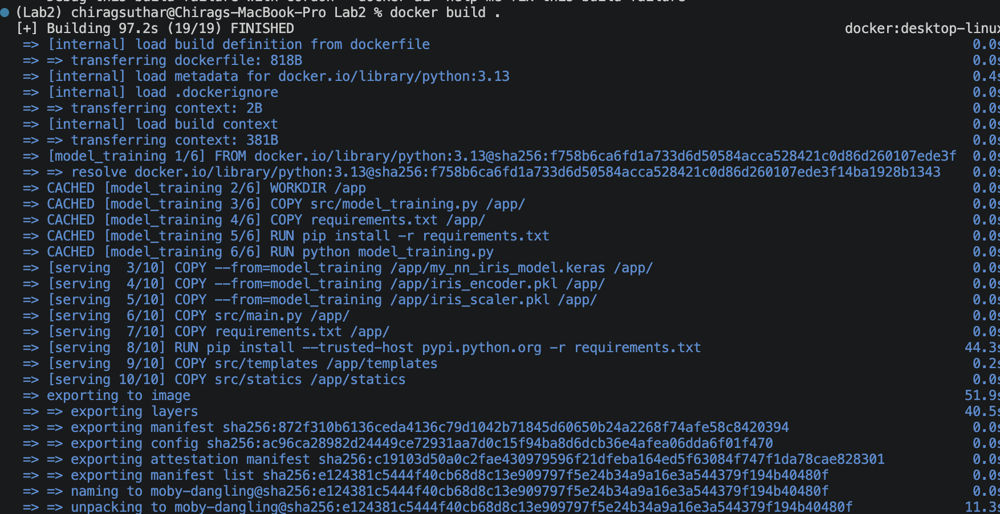
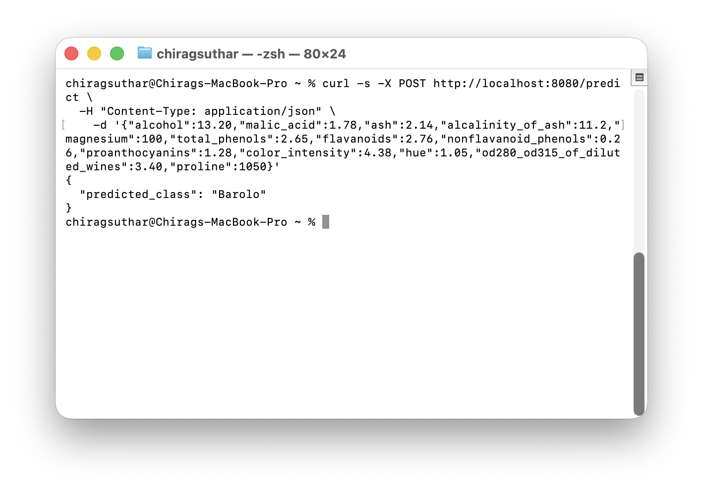
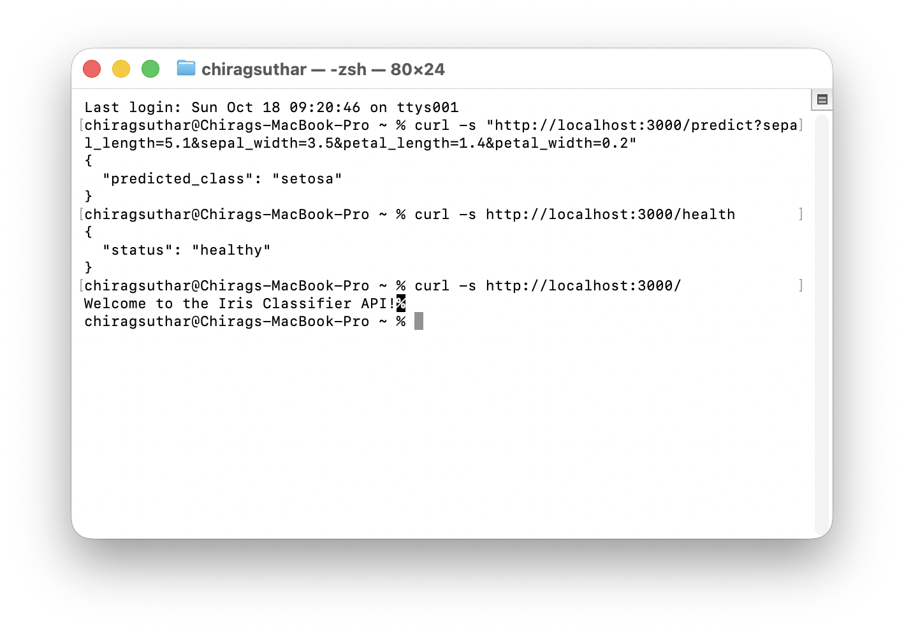
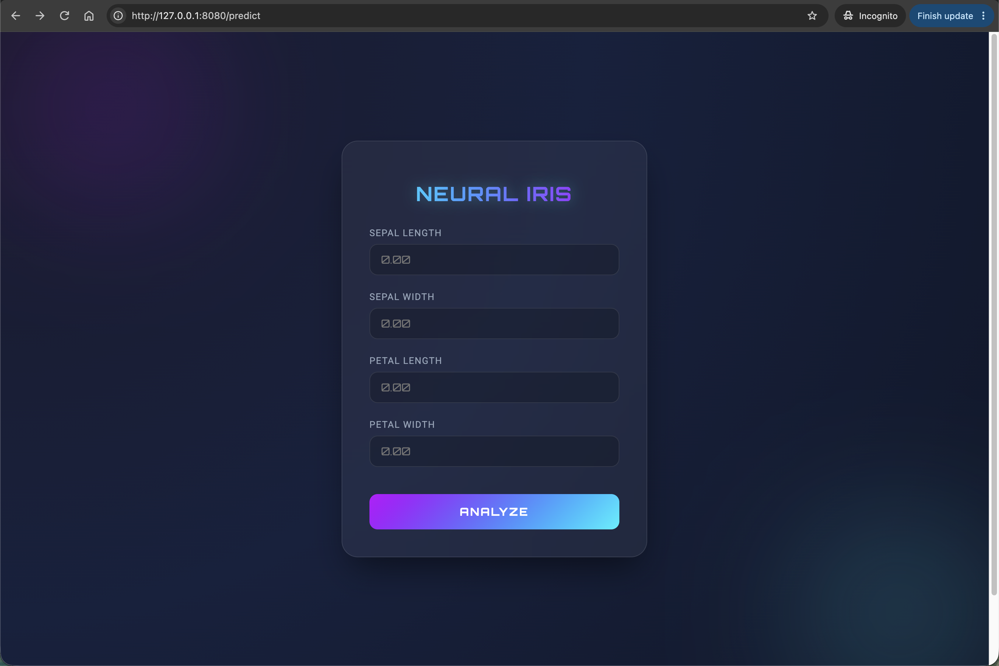
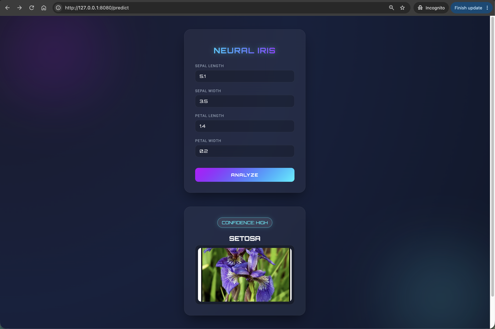

# Docker Lab 2 — Iris Classifier using Tensorflow (Docker)

This document walks you thought the changes and how to start up the project

## Training ([src/model_training.py](https://github.com/ChiragSuthar001/MLOps/blob/main/Labs/Docker_Labs/Lab2/src/model_training.py))

The training script uses scikit-learn's built-in Iris dataset. It one-hot encodes the
labels, splits the data into 80% training and 20% test data, standardizes the features,
and trains a three-class neural network with Keras for 100 epochs.

I am saving three things at the end of the model training

- `Model` -> The trained model with the final weights saved as `'my_nn_iris_model.keras'`
- `Scaler` -> The Standard Scaler used during training to be used during inference to ensure accurate rescaling during inference.
- `Encoder` -> The one hot encoder, so that during inference we can dynamically get the class name without relying on the same class sequence during inference. To reduce chances of error.

### Run training locally

From the project root, install the dependencies and run the training script:

```bash
python3 -m pip install -r requirements.txt
python3 src/model_training.py
```

The script evaluates the model on the test set and writes these files to the project
root:

- `my_nn_iris_model.keras` - the trained Keras model
- `iris_encoder.pkl` - the fitted label encoder
- `iris_scaler.pkl` - the fitted feature scaler

These artifacts are loaded by `src/main.py` when the prediction API starts.

### Train as part of the Docker build

The first stage of the `dockerfile` installs the dependencies and runs
`model_training.py` automatically. Build the image from the project root:

```bash
docker build -f dockerfile -t iris-classifier .
```

The generated model, encoder, and scaler are copied into the serving stage of the image, so no separate training command is required before starting the container, and the model works out of the box for the final container image.

## Flask API ([src/main.py](https://github.com/ChiragSuthar001/MLOps/blob/main/Labs/Docker_Labs/Lab2/src/main.py))

- Loads `my_nn_iris_model.keras`, `iris_scaler.pkl` and `iris_encoder.pkl` results from the model training at start up. If any of these files are missing it would throw an exception at the start time.
- `GET /health` returns the health of the server
- `GET /predict` with empty body returns the HTML page for browser viewing.
- `GET /predict` with request args returns JSON response.
- `POST /predict` with request form data or json, returns json response for requests from browser.

## Web UI (src/template/)

- Used the default `predict.html` - just changed the switch to match my input to the html file.

# Use of Docker

Used docker to multi-stage build to make a light weight final image with weights of the trained model which can be used to out of the box directly without needing another training.

## Mutli-stage build:
- **Stage: `model_training`** trains the model while only copying the needed files for training. `src/model_training.py` and `requirements.txt`.
- **Stage: `serving`** - the Final stage in the dockerfile which by the rule of docker 'the final image is the last reachable FROM stage'. It only contains the code that runs the model trained in previous stage. It copies the three files model files created in first stage and then serves them through `main.py`.
- **`Expose: 80`** exposes the port 80

Used `.dockerignore` to exclude all the files and folders not necessary for the build and remove noise from rebuilds.

## How to Run the Project with Docker

All the commands needs to run in the directory (`Labs/Docker_Labs/Lab2`)

### Prerequisites

- Docker Deamon running

### Get to the folder

From the root of the repository:
```bash
pushd Labs/Docker_Labs/Lab2
```

### Build the image

```bash
docker build -t my_iris_app .
```
First build might take a few minutes.

This will build the docker image named 'my_iris_app'. You can verify the image listed in the docker desktop or with the following command:
```bash
docker image list | grep my_iris_app
```

### Run the container with the built image
```bash
docker run --rm -p <PORT>:443 my_iris_app
```
`<PORT>` - Put desired port to run the application on host system.

e.g. `docker run --rm -p 8080:443 my_iris_app` will run the app on `localhost:8080`

<details>
    <summary>
        <b>OR</b>: If Background run is desired (typical for testing with `curl` / browser)
    </summary>

```bash
docker run --rm -d --name iris -p 8080:8080 my_iris_app
```
</details>

## Verify with cURL

Assuming docker container is running on `8080`

```bash
curl -s http://localhost:8080/health
curl -s http://localhost:8080/
curl -s "http://localhost:8080/predict?sepal_length=5.1&sepal_width=3.5&petal_length=1.4&petal_width=0.2"
curl -s "http://localhost:8080/predict_knn?sepal_length=5.1&sepal_width=3.5&petal_length=1.4&petal_width=0.2"
```

JSON **POST** example:

```bash
curl -s -X POST http://localhost:8080/predict \
  -H "Content-Type: application/json" \
  -d '{"sepal_length":5.1,"sepal_width":3.5,"petal_length":1.4,"petal_width":0.2}'
```

### Verify in the browser

- [http://127.0.0.1:8080/](http://127.0.0.1:8080/) — welcome message  
- [http://127.0.0.1:8080/health](http://127.0.0.1:8080/health) — health JSON  
- [http://127.0.0.1:8080/predict](http://127.0.0.1:8080/predict) - Predict HTML page

</br>

<details>
    <summary>
    <h1 style="display: inline;">Optional: Docker Compose</h1>
    </summary>

Make sure you are in the directory - `Labs/Docker_Labs/Lab2`

```bash
docker compose up
```

when done, the compose can be turned down with:
```bash
docker compose down
```

</details>

<br/>
<br/>

# Screenshots

### Docker Build Success



### cURL test with JSON




### cURL test with arguments



### Browser Test with Webpage



### Browser prediction test

